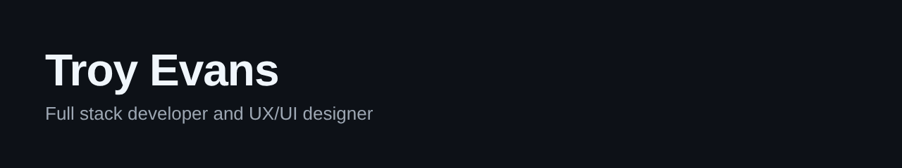

  

## About Me

I'm a second year Bachelor of Creative Technologies student at Open Window, specialising in UX/UI and interactive development. I like taking a project from the first Figma frame through to a working deployment, so I understand both why a screen looks the way it does and what it takes to run it. Alongside my studies I freelance in video editing and web design.

## Skills and Career Focus

- **Full stack development** with the MERN stack and PHP with MySQL, currently learning Shopify theme development
- **UX/UI design** from research and wireframes through to tested interfaces in Figma
- **Deployment** on AWS and Azure with Nginx, PM2 and MongoDB Atlas
- **Freelance video editing** in DaVinci Resolve

**Where I'm heading.** I'm looking for full stack and UX engineering work, with a growing interest in ecommerce development and conversion optimisation. Long term, I want to move into technical product management.

## Tech Stack

## Currently Learning

## Main Projects (DV200 Portfolio)

| Project | What it is | Built with |
|---|---|---|
| **[The Holocron Archive](https://github.com/Troy-jsx/TroyEvans_251096_DV200_Semsester1_API)** | Star Wars data dashboard built on an external API | React, Chart.js, SWAPI |
| **[CypherID](https://github.com/Troy-jsx/CypherID)** | Passwordless login using a personal cipher | MongoDB, Express, React, Node.js |
| **[Made Men](https://github.com/Troy-jsx/Made-Men)** | Browser based mafia simulator | PHP, MySQL, Tailwind CSS |
| **[Paws and Purrs Hub](https://github.com/Troy-jsx/Paws-and-Purrs)** | Animal shelter donor and admin dashboard | MongoDB, Express, React, Node.js |

## Group Projects

- **[Retro Rat](https://github.com/DVAtors/Retro-Rat)** is a moderated marketplace for retro electronics in South Africa, built with the MERN stack as a group project. I was one of the UI designers and worked mainly on the backend, building the database schemas and the cart API, then connecting them to the frontend. I also deployed my own copy on AWS and Azure and set up its analytics and SEO. [See it live](http://retro-rat.ddns.net).

## GitHub Stats

| Project | Last commit | Code size | Top language |
|---|---|---|---|
| The Holocron Archive |  |  |  |
| CypherID |  |  |  |
| Made Men |  |  |  |
| Paws and Purrs Hub |  |  |  |

## Contact

- Email [251096@virtualwindow.co.za](mailto:251096@virtualwindow.co.za)
